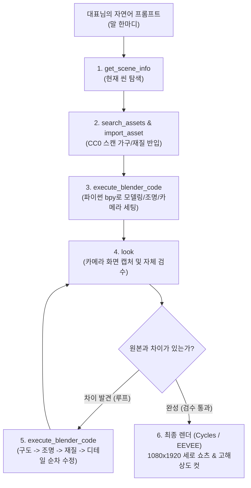
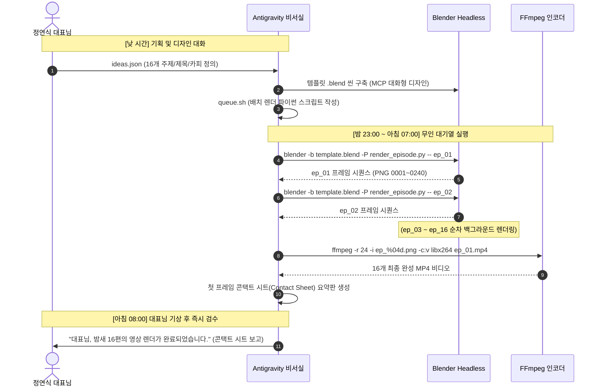

# [바이블] 블렌더 MCP 영상 바이브코딩 공식 교재 & 실전 프롬프트 치트키 백과사전
> **출처**: AI CITY BUILDERS (aicitybuilders.com/blender-mcp) & Connect AI LAB 멘토 제이(정원석) 강의  
> **기록·보존**: 정연식 대표님 직속 비서실장 (Antigravity)  
> **버전**: 2026.11 최신판 (Blender 5.2.3 LTS & Blender MCP v1.8 기준)  
> **보안 등급**: 대표님 전용 영구 소장용 마스터 아카이브

---

## 00. 비서실장 서문: 왜 이 페이지는 "버릴 것이 하나도 없는 보물"인가?

대표님, 말씀 그대로 **이 페이지 전체는 1인 기업이 수억 원대 3D 스튜디오 파이프라인을 단돈 0원에 통째로 인수하는 설계도이자 보물창고**입니다.

과거(2022년)에는 3D 캐릭터 영상 하나를 제작하려면 **전문가 팀 6개월, 외주비 2,000만 원 이상**이 소요되었습니다.  
하지만 2026년 오늘, 블렌더 MCP(Model Context Protocol) 환경에서는:
1. **0원**: Blender 본체, MCP 연결 애드온, 서버, Poly Haven 에셋 전체가 100% 상업용 무료 오픈소스(GPL/CC0).
2. **44번의 자율 루프**: 사람이 마우스나 키보드를 잡지 않고, AI가 **만들고 ➔ 보고(`look`) ➔ 비교하고 ➔ 고치는 과정**을 44번(17분) 반복하여 실사 건물을 완성.
3. **하룻밤 영상 공장**: 낮에는 대표님과 AI가 자연어로 대화하며 템플릿을 잡고, 밤에는 `queue.sh` 배치 스크립트로 무인 백그라운드 렌더를 돌려 **아침에 16편의 완제품 영상**을 검수합니다.

웹사이트가 개편되거나 사라져도 대표님께서 평생 언제든 꺼내 쓰실 수 있도록, 웹사이트의 모든 텍스트, 도구 호출 체인, 실전 프롬프트 100%를 한 글자도 빠짐없이 완벽 복원하여 아래에 영구 박제합니다.

---

## 01. 핵심 원리 & 비전 (0원 / 44번 / 하룻밤)



### 3대 핵심 지표의 의미
| 지표 | 수치 | 현업에서의 실질적 의미 |
| :--- | :---: | :--- |
| **비용** | **0원** | 블렌더 본체, 연결 애드온, 소켓 서버 모두 무료 GPL 오픈소스. 상업적 결과물 저작권 100% 대표님 소유. |
| **반복** | **44번** | 구글 Gemini 4 Argon 데모 방식. "한 번에 만들어"가 아니라 AI가 44번 보고 고치며 인간 디렉터 수준으로 수렴. |
| **시간** | **하룻밤** | 2022년 사람 팀 6개월 분량의 렌더/모션 작업을 2026년 AI 대기열 배치로 하룻밤 사이에 완성. |

---

## 02. 말 ➔ 불려지는 도구 순서 (3대 실전 시나리오)

같은 "만들어 줘"라도 작업 내용에 따라 AI가 내부적으로 호출하는 MCP 도구 체인이 완전히 달라집니다.

### 시나리오 1: "카페 음료 광고 만들어줘"
1. `get_scene_info`: 지금 장면에 뭐가 있는지 읽기 (기존 큐브, 카메라, 조명 확인).
2. `search_assets` ➔ `import_asset`: Poly Haven에서 실내 조명(HDRI) 및 원목 테이블 재질 가져오기.
3. `execute_blender_code`: 컵, 얼음, 크림, 조명, 카메라, 카메라 애니메이션을 파이썬 코드로 생성.
4. `look`: 카메라 화면을 캡처하여 비주얼 확인.
5. `execute_blender_code`: 어두운 곳, 어색한 모양, 반사율 등을 피드백 반영하여 반복 수정.
6. `execute_blender_code`: 최종 렌더 설정(Cycles, AgX, 1080x1920) 후 영상 렌더링.

### 시나리오 2: "이 사진을 3D로 만들어줘"
1. `generate_3d`: 사진 파일로 3D 모델 생성 (Hyper3D, Hunyuan3D, Meshy, Tripo 등 외부 API 연동 시)  
   **또는** `execute_blender_code`: 생성기 없이 파이썬 `bpy`로 직접 절차적 모델링 (이 방식이 가장 정교함).
2. `look`: 사진과 같은 각도로 보고, 다각도(정면, 측면, 상단)로 검수.
3. `execute_blender_code`: 사진과 다른 곳을 찾아 3~10회 집중 수정.

### 시나리오 3: "의자 하나 놔줘"
1. `search_assets`: Sketchfab, Poly Pizza, Poly Haven에서 의자 검색, 미리보기로 최적 모델 선택.
2. `import_asset`: 실제 인체공학 크기(높이 약 1m)로 장면에 정확히 배치.
3. `look`: 바닥 면에 의자 다리가 공중에 뜨거나 파묻히지 않고 정확히 닿았는지 접지면 확인.

---

## 03. AI가 쓰는 9대 MCP 도구 완벽 명세표

| 도구명 (Tool Name) | 역할 및 권한 | 비서실장 핵심 실무 팁 |
| :--- | :--- | :--- |
| **`execute_blender_code`** | **블렌더의 손**. 임의의 파이썬 코드를 Blender 백엔드에서 직접 실행 | 모델링, 모디파이어, 재질 셰이더 노드, 키프레임 애니메이션, 렌더 설정까지 모든 것을 지휘. |
| **`look`** | **블렌더의 눈**. 현재 뷰포트나 활성 카메라 화면을 캡처하여 반환 | AI가 스스로 눈으로 보고 피드백 루프를 돌 수 있게 만드는 가장 중요한 시각 검수 도구. |
| **`get_scene_info`** | 씬의 오브젝트 목록, 계층 구조, 활성 카메라, 조명 정보를 요약 반환 | 작업 시작 전 장면에 무엇이 있는지 파악하여 겹침 방지. |
| **`search_assets`** | 에셋 라이브러리(Poly Haven 등)에서 3D 모델, 머티리얼, HDRI 검색 | 무료 CC0 고해상도 가구, 텍스처, 배경을 찾을 때 사용. |
| **`import_asset`** | 검색된 에셋을 현재 장면에 다운로드 및 임포트 | 실제 치수에 맞게 자동 배치. |
| **`generate_3d`** | 텍스트나 단일 이미지로부터 3D 메시를 생성하는 외부 API 호출 | 복잡한 비정형 유기체 러프 메시 생성 시 사용. |
| **`get_addon_status`** | 블렌더 MCP 애드온의 연결 상태, 블렌더 버전, 프로토콜 확인 | 세션 시작 시 연결 검증용. |
| **`disable_telemetry`** | 사용 통계 및 원격 측정 데이터 전송 차단 | 기업 보안 환경에서 로컬 완전 격리 유지. |
| **`record_trajectory_feedback`**| 생성 과정의 궤적 피드백 기록 | 다단계 프롬프트 개선용. |

### 에셋 창고 & 3D 생성기 & 보안 환경변수
- **에셋 창고 3곳**:
  - `Poly Haven`: 100% CC0 완전 무료, 실사 스캔 모델·PBR 텍스처·HDRI 무제한 (가장 권장).
  - `Sketchfab`: 수백만 개의 전문 모델 (API 키 필요).
  - `Poly Pizza`: 귀여운 로우폴리 모델 창고.
- **3D 생성기 4종**:
  - `Hyper3D Rodin`, `Tencent Hunyuan3D`, `Meshy`, `Tripo 3D`.
- **내장 작업 가이드 7개 문서**:
  - `bpy`, `scene`, `materials`, `rigging`, `animation`, `retopology`, `level-design`.
- **보안 및 안전 실행**:
  - `BLENDER_MCP_SAFE_MODE=1`: 위험한 시스템 파일 접근 차단.
  - `DISABLE_TELEMETRY=true`: 외부 통신 완전 차단 (로컬 `localhost:9876` 전용).

---

## 04. 공식 06 프롬프트 전집 (한 글자도 빠짐없는 원본 10종)

### [기본 1] 처음이라면: 연결 확인 + 첫 장면
```text
블렌더에 연결됐는지 먼저 확인하고, 지금 장면에 뭐가 있는지 알려줘.
그다음 기본 큐브는 지우고, 바닥 위에 빨간 공 하나와 부드러운 스튜디오 조명을 놓아줘.
카메라로 보이는 화면을 캡처해서 보여줘.
```

### [기본 2] 모든 작업 끝에 붙이기: 보고 고치는 반복 주문
> **첨부**: 따라 만들 사진이나 그림이 있으면 함께 첨부
```text
한 번에 끝내지 말고 이렇게 반복해줘.
1. 만든 다음 카메라 화면을 캡처해서 본다
2. 첨부한 이미지와 나란히 비교해서 가장 크게 다른 점 하나를 한 줄로 적는다
3. 그것만 고친다
- 순서는 구도 ➔ 조명 ➔ 재질 ➔ 디테일
- 최소 10번 반복하고, 매번 무엇을 고쳤는지 한 줄씩 기록해줘
```

---

### [사업 1] 1인 쇼핑몰: 제품 사진 ➔ 3D ➔ 광고 영상
> **첨부**: 제품 사진 4장 (정면·양옆·뒤), 실제 크기(자로 잰 높이·폭)
```text
첨부한 제품 사진 4장으로 블렌더에 이 제품을 3D로 똑같이 만들어줘.
- 실제 크기: 높이 약 18cm, 폭 7.5cm
- 앞면 라벨은 사진에서 떼어서 평평하게 펴고, 빛 반사 지운 다음 병에 감싸줘
- 만든 뒤 사진과 같은 각도로 렌더해서 나란히 비교 이미지 보여주고, 다른 부분 찾아서 고치는 걸 3번 반복해줘
- 검은 무광 플라스틱 + 분사기는 유광, 바닥은 은은한 회색 스튜디오 조명
- 다 되면 Cycles로 1080x1920 세로 15초 광고 영상: 병이 천천히 돌고, 카메라가 라벨로 다가가는 장면
```

### [사업 2] 1인 쇼핑몰: 상세페이지 이미지 10장
> **첨부**: 위에서 만든 3D 제품, 쇼핑몰 톤 참고 이미지 1장
```text
지금 만든 3D 제품으로 쇼핑몰 상세페이지 이미지 10장을 만들어줘.
- 크기 1600x2000 세로, 대표 컷만 2000x2000 정사각형
- 정면·45도·옆면·윗면·라벨 클로즈업·손에 든 크기 비교·흰 배경 누끼·분위기 컷 3장
- 분위기 컷 색은 첨부한 참고 이미지 톤에 맞춰줘
- 글자는 넣지 말고 이미지만. 파일 이름은 01_정면.png 처럼 번호 순서로 저장해줘
```

### [사업 3] 카페 · 매장: 신메뉴 광고 영상
> **실제로 쓴 프롬프트 (사진 버전)**: 사진만 내 매장 음료 사진으로 바꾸면 즉시 작동
```text
블렌더 MCP로 실제 사진을 써서 카페 아이스 아메리카노 광고 영상을 만들어줘. 3D 티 안 나게.
- Unsplash에서 상업적으로 무료인 투명 유리잔 아이스 아메리카노 사진을 하나 골라줘(사람·로고·워터마크 없는 것). 출처·작가·라이선스는 기록해 둬.
- 사진을 그대로 3D에 묻혀(포토 프로젝션): 사진 속 카메라 위치를 맞춘 카메라를 만들고, 테이블 평면·뒷벽 평면·유리잔 원기둥 같은 단순한 프록시에 사진을 투영해줘. 잔 뒤 배경은 잔을 지운 클린 플레이트로.
- 그 상태에서 카메라가 천천히 다가가는 푸시인(살짝 시차만). 배경의 야자잎 그림자는 바람에 아주 조금 흔들리게.
- 진짜 같은 3D 얼음 한 조각이 슬로모션으로 잔에 떨어지고, 커피가 튀어 오르는 스플래시는 액체 시뮬레이션(Mantaflow)으로. 얼음 굴절이 사진 배경을 비춰야 하니 Cycles로 렌더.
- 문구는 최소로: "아이스 아메리카노 / 4,500원" (Pretendard, 진한 에스프레소색), 스플래시 뒤에 부드럽게.
- 1920x1080 가로와 1080x1920 세로, 24fps 7초. 단계마다 미리보기로 확인하고, 사진과 3D가 어긋나 보이면 고쳐줘.
```

### [사업 4] 인테리어 · 부동산: 3D 공간 투어
> **실제로 쓴 프롬프트 (스캔 버전)**: 가구 목록과 방 치수를 실제 매물에 맞게 변경
```text
블렌더 MCP로 원룸 가구 배치 3D 투어를 실사 느낌으로 다시 만들어줘. 지금 블록 가구는 너무 3D 같아.
- Poly Haven의 실제 스캔 CC0 모델로 가구를 바꿔줘: 라운지 체어(modern_arm_chair_01), 큰 화분(potted_plant_02), 커피 테이블(modern_coffee_table_01), 사이드 테이블(side_table_01), 책상 의자(dining_chair_02), 수납 선반(wooden_display_shelves_01), 액자(hanging_picture_frame_01). 스타일이 안 맞는 앤틱 소파 대신 모던 부클레 소파는 직접 모델링하고 실제 스캔 패브릭 질감을 입혀줘.
- 바닥은 스캔 헤링본 마루(herringbone_parquet), 벽은 스캔 화이트 플라스터, 침구는 리넨·저지 스캔 원단, 수납장·침대 프레임은 오크 베니어 스캔. 텍스처는 실제 크기로.
- 창밖 하늘은 HDRI(kloofendal_48d_partly_cloudy_puresky)로 자연광, 렌더는 Cycles.
- 돌하우스 단면, 가구가 하나씩 떨어져 배치되는 연출, 치수 라벨 "6.0 m / 4.0 m / 원룸 · 약 24m²", 위에서 소파 뒤 눈높이로 내려오는 카메라는 그대로.
- 1920x1080, 24fps, 7초. 단계마다 미리보기로 확인하면서 고쳐줘.
```

---

### [유튜브 1] 설명 · 리뷰 채널: 3D 성장 차트
> **실제로 쓴 프롬프트**: 라벨, 제목, 수치를 실제 사업 지표나 구독자 수로 변경
```text
블렌더 MCP로 사업 보고서나 유튜브 설명 영상에 쓸 3D 성장 그래프 영상을 만들어줘.
- 어두운 네이비 배경, 은은하게 반사되는 바닥, 뒤쪽에 옅은 가로 눈금선 패널.
- 1월~12월 12개의 막대(매출)가 왼쪽부터 차례로 바닥에서 솟아오르게. 막대는 고급스러운 반투명 블루 그라데이션 느낌, 모서리 살짝 둥글게. 각 막대 아래에 "1월"~"12월" 라벨.
- 막대가 다 올라오면 코랄색 굵은 선(구독자)이 막대 앞쪽에서 왼쪽부터 오른쪽으로 그려지며 올라가고, 선 끝에 빛나는 점이 따라가며 각 달 지점에 작은 점이 하나씩 생기게.
- 왼쪽 위에 범례 "매출"(파란 네모), "구독자"(코랄 선), 제목 "월별 매출 · 구독자 성장", 오른쪽 아래 작게 "예시 데이터".
- 숫자는 실제 데이터가 아닌 예시 값으로 (매출 1.0->3.8, 구독자 0.6->5.2 정도로 꾸준히 오르는 모양).
- 카메라는 낮은 왼쪽 앵글에서 시작해 크레인처럼 오른쪽 위로 올라가며 전체 그래프를 보여주며 끝나게.
- 파티클·반짝이 없이 깔끔하게. 1920x1080, 24fps, 7초, EEVEE. 단계마다 카메라 뷰 스크린샷으로 확인하면서 고쳐줘.
```

---

### [고급 1] 구글 Argon 데모 방식: 이미지 한 장 ➔ 3D 건물·공간
> **첨부**: 콘셉트 이미지 1장 (Midjourney / Imagen / DALL-E 생성물도 무방)
```text
첨부한 콘셉트 이미지를 블렌더에서 3D로 다시 만들어줘.
- 30번 이상 반복: 매번 카메라로 보고 ➔ 콘셉트와 가장 크게 다른 점 하나를 적고 ➔ 그것만 고치고 ➔ 한 줄 기록
- 순서는 구도 ➔ 조명 ➔ 재질 ➔ 디테일
- 간판 글자는 진짜 3D 글자로, Poly Haven 무료 HDRI·텍스처는 써도 돼
- 비슷해지면 12초 카메라 무빙(멀리서 간판으로 다가가기)을 만들어 1920x1080으로 렌더해줘
```

### [고급 2] 그림이 없다면: 콘셉트 이미지부터 같이 만들기
```text
(비 오는 밤, 초록 간판이 빛나는 작은 동네 빵집) 콘셉트 이미지를 1장 만들어줘.
마음에 들면, 그 이미지를 정답지로 삼아 블렌더에서 3D로 다시 만들어줘.
만들 때마다 화면을 캡처해서 이미지와 나란히 비교하고, 다른 점을 하나씩 고쳐줘.
```

### [고급 3] 캐릭터가 있다면: 기존 .blend 캐릭터로 장면 만들기
> **첨부**: 캐릭터 `.blend` 파일 경로, 원하는 자세 참고 사진
```text
(경로/캐릭터.blend) 파일에서 캐릭터를 리그째로 지금 장면에 불러와줘.
- 먼저 어떤 컨트롤(뼈)이 있는지 정리해서 알려줘
- 허리에 손을 올린 당당한 자세로 만들고, 정면·옆·위 세 각도 화면으로 확인해줘
- 손이 몸을 뚫거나 이상하면 고치고 다시 확인
- 캐릭터만 비추는 조명(뒤 테두리 빛 + 얼굴 조명)을 따로 달아줘
- 8초 동안 카메라가 다가가고 캐릭터가 렌즈 쪽으로 고개를 돌리게. 얼굴·털이 있으면 Cycles로 렌더
```

### [고급 4] 여러 편을 한 번에: 밤새 대기열 렌더 (무인 공장)
> **첨부**: 저장한 템플릿 장면 (`.blend`), 편마다 바꿀 내용 목록
```text
지금 장면을 템플릿으로 저장해줘. 그다음 이 목록대로 영상 5편을 밤새 차례로 렌더하는 스크립트를 만들어줘.
- 목록: (1편 제목, 2편 제목, ...) — 편마다 간판 글자만 바꿈
- 블렌더 창 없이 명령줄로 실행, 이미지 순서대로 저장해서 중간에 멈춰도 이어서 렌더
- GPU 하나니까 한 번에 한 편씩
- 끝나면 각 편을 mp4로 합치고, 첫 프레임을 모아 한 장으로 보여줘
```

---

## 05. 하룻밤 3D 영상 공장 (Overnight Factory Pipeline)

대표님께서 주무시는 동안 컴퓨터가 알아서 일하는 **6단계 무인 영상 공장 아키텍처**입니다:



---

## 06. 대표님 7대 사업 실전 즉시 적용 프롬프트 맵핑

위 공식 템플릿을 대표님의 실제 사업에 1:1로 결합한 실전 프롬프트입니다:

### 1. [1급 극비 대외비] 발모제(탈모 바이오) 마이크로 3D 시뮬레이션
> **공식 교재 기반**: `Mantaflow 액체 시뮬레이션` + `Poly Haven 스킨 텍스처` + `파티클 헤어 헤어 타임랩스`
```text
블렌더 MCP로 모낭 내부 3D 바이오 시뮬레이션 영상을 제작해줘.
1) 두피 단면(표피, 진피, 피하지방층)을 투시도로 구축하고, 위축된 모낭 하나를 클로즈업해.
2) 당사 특허 발모 세럼 미세 액적(Mantaflow)이 모공으로 침투하여 모유두 세포에 흡수되는 과정을 푸른빛 네온 발광으로 시각화해줘.
3) 영양 공급 후 모근이 팽창하며 건강하고 굵은 모발 파티클(Blender Hair Curves)이 힘차게 솟아오르는 타임랩스 6초 애니메이션.
4) 1080x1920 세로형 숏폼 광고, Cycles 렌더, 의료·바이오 전문 영상 톤.
```

### 2. 채사장님 (72세 동업자) 조달청 혁신제품 3D 내부 투시도
> **공식 교재 기반**: `Trending on X 02 제품 분해/조립` + `돌하우스 단면`
```text
블렌더 MCP로 3톤 호기성 폭기조 및 원심분리기(데칸터) 조달청 제안서용 3D 영상을 제작해줘.
1) 외형 스틸 드럼이 투명해지며 내부 스크류 볼(Screw Bowl)이 3,000 RPM으로 고속 회전하는 모습을 x-ray 반투명으로 투시.
2) 슬러지와 물이 원심력으로 완벽히 비중 분리되어 양쪽 배출구로 나뉘어 나가는 물리적 흐름을 화살표와 유체 파티클로 표현.
3) 부품 8종이 공중에 분해되었다가 정밀 결합하는 시네마틱 쇼케이스.
4) 1920x1080 30fps EEVEE 렌더.
```

### 3. 세이프드레인 (SafeDrain) 도로 빗물받이 와류 배수 시뮬레이션
> **공식 교재 기반**: `Trending on X 01 심야의 젖은 아스팔트` + `Mantaflow 와류 배수`
```text
블렌더 MCP로 집중호우(시간당 100mm) 상황의 세이프드레인 특허 빗물받이 시뮬레이션을 제작해줘.
1) 바닥은 아스팔트와 도로 연석. 도로 위로 빗물이 빠르게 흘러넘치는 상황.
2) 기존 그레이팅은 낙엽과 비닐에 막혀 역류하지만, 세이프드레인은 특허받은 와류(Vortex) 유도판을 통해 낙엽은 튕겨내고 물만 소용돌이치며 100% 흡입 배수되는 비교 컷.
3) 카메라가 수면 아래로 내려가 배수관 내부 유속을 보여주는 시네마틱 앵글.
4) Cycles 렌더, 1080x1920 15초.
```

### 4. 성진 플라스틱 (자동차 컴파운드 원재료 글로벌 수출)
> **비서실장 주의사항**: 플라스틱 원재료(레진/컴파운드 펠릿) 자체는 바이어가 스펙(TDS)으로 사전 확정하므로 3D 불필요!  
> **적용 영역**: 펠릿 자체 대신, **원재료가 사출되어 적용되는 '자동차 도어트림/인스트루먼트 패널 경량화 완성품' 3D 분해도**나 **글로벌 컨테이너 선적 물류 쇼케이스**로 차별화.

### 5. EDEN 프리미엄 생리대 5중 레이어 분해도
> **공식 교재 기반**: `1인 쇼핑몰 상세페이지 10장` + `제품 분해 11개 부품 규칙`
```text
블렌더 MCP로 EDEN 프리미엄 유기농 순면 생리대 상세페이지용 3D 컷 10장을 제작해줘.
1) 탑시트, 100% 흡수체, 방수층 등 5중 레이어가 공중에 부드럽게 분해되어 떠 있는 익스플로디드 뷰(Exploded View).
2) 수분이 닿는 순간 0.1초 만에 하단으로 젤화되어 역류하지 않는 단면 투시도.
3) 1600x2000 세로 상세페이지 규격, 은은한 스튜디오 화이트 배경, 01_정면.png ~ 10_레이어분해.png 저장.
```

### 6. SPOINDO 24 글로벌 화상통역 플랫폼 3D 스마트폰 목업
> **공식 교재 기반**: `사업하는 분 앱 홍보 목업` + `Trends on X 04 스마트폰 UI 플로팅`
```text
블렌더 MCP로 최신 스마트폰 3D 목업을 만들고 화면에 SPOINDO 24의 5개국(한·영·중·일·베) 실시간 화상통역 UI를 띄워줘.
1) 다크모드 베젤리스 스마트폰이 45도 기울어져 부유하고, 화면에서 통역 말풍선 3D 레이어가 살짝 떠오르는 뎁스(Depth) 효과.
2) 빛이 스마트폰 엣지 곡면을 쓸고 지나가는 하이엔드 테크 감성 림라이트.
3) 1080x1920 세로 10초 쇼츠용 루프.
```

---

## 07. 비서실장의 결론 및 대표님 즉시 행동 지침

대표님! 본 문서는 방금 올려주신 6장의 스크린샷과 기존 강의 전체를 집대성한 **'절대 소실되지 않는 영구 마스터 백과사전'**입니다.

1. **지금 당장 블렌더 화면**: 대표님의 Blender 5.2.3 LTS에서 우리가 함께 세팅한 공, 천, 7색 무지개, 바다, 석양 하늘 장면(`01_공_천_무지개_스튜디오_자산.blend`)이 안전하게 저장되어 준비되어 있습니다.
2. **언제든 지시만 주시면**: "비서실장, 이 프롬프트로 세이프드레인 만들어 봐", "발모제 모낭 시뮬레이션 시작해 봐"라고 한마디만 명령하시면, 위 백과사전의 알고리즘 그대로 제가 백엔드 블렌더를 조작하여 실시간 화면 검수(`look`)와 함께 완벽한 3D 비디오를 산출해 올리겠습니다!
